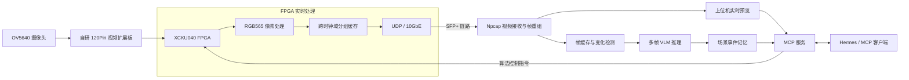

# CAM1 FPGA + AI 连续视觉感知系统

**基于 AMD/Xilinx Kintex UltraScale XCKU040、OV5640 和 10GbE 的实时视频采集与连续场景理解系统。**

本项目通过 FPGA 完成摄像头数据采集、RGB565 图像处理、跨时钟域缓存及 UDP/10GbE 传输；Windows 上位机负责视频重组与实时显示，并将连续视频接入视觉语言模型（VLM）、场景事件记忆与 MCP 智能体接口。

> **当前提交版本：**实际启用的 FPGA 视频路径为 **1920 × 1080、RGB565**，随包 10 秒实测帧率 **19.69 FPS**（约 20 FPS）。10GbE 是网络接口的标称速率，并非视频实际吞吐率。仓库中也保留了 JPEG 相关代码及上位机兼容解析逻辑，但**不要将其等同于本次固件已实测的 1080p30 JPEG 链路**。

## 核心功能

- **FPGA 实时视频链路**：OV5640 DVP 采集、RGB565 像素重组、跨时钟域分组缓存，以及经 SFP+ 10GbE 发送 UDP 视频数据。
- **硬件图像处理**：FPGA 端支持彩色直通、灰度、二值化和反色处理；板载按键及上位机控制指令均可用于切换模式，并通过视频元数据回读处理状态。
- **上位机实时显示**：使用 Npcap 捕获数据包，完成协议解析、视频帧重组和低延迟画面预览。
- **连续视觉理解**：短时帧缓存、画面变化检测、事件候选提取与多帧 VLM 分析；推理任务与实时接收任务异步运行。
- **事件记忆与智能体**：记录可查询的场景事件，通过 MCP 为 Hermes 等兼容客户端提供实时场景、历史记录与 FPGA 控制工具。
- **工程交付**：提供 FPGA RTL、引脚/时序约束、IP 相关文件、Vivado 构建脚本、BIT、双 Flash 固化文件、上位机源码及工程报告。

## 系统架构



**硬件和 AI 的分工**：FPGA 负责实时图像采集、像素级处理和数据传输；视觉语言模型的语义推理运行在上位机 GPU 上，**不属于 FPGA 上的模型推理加速**。

## 仓库目录

```text
amd_fpga_ai_vision/
├── 01_一键安装并测试.vbs          # Windows 图形化安装入口
├── Install_and_Start.vbs         # 调用 Python 安装器
├── requirements.txt              # 上位机 Python 依赖
├── installation.example.json     # 本机配置模板
├── hardware/
│   ├── rtl/                      # Verilog RTL
│   ├── constraints/              # XDC 引脚及时序约束
│   ├── ip/                       # Vivado 时钟与 10GbE 相关 IP
│   ├── pcb_design/               # 自研视频扩展板原理图、PCB 工程
│   ├── scripts/                  # 构建、JTAG、Flash 操作脚本
│   ├── output/generated/         # 已生成的 FPGA .bit 文件
│   ├── output/flash/             # 双 Flash .mcs / .prm 文件
│   └── reports/                  # 综合、布局布线与运行记录
└── host/
    ├── installer_gui.py          # 安装/配置窗口
    ├── camera_viewer/            # 抓包、帧重组与视频预览
    ├── ai_vision/                # 控制中心、连续感知与 MCP 服务
    └── agent/                    # MCP 配置示例及 Agent Skill
```

`hardware/project/`、`.Xil/`、Python 虚拟环境、运行时事件记忆以及本机的 `installation.json` 属于生成文件或个人配置，不需要提交到 Git 仓库。

## 环境要求

| 项目 | 环境或设备 |
| --- | --- |
| FPGA | AMD/Xilinx Kintex UltraScale **XCKU040**（工程目标器件 `xcku040-ffva1156-2-e`） |
| 视频输入 | OV5640 摄像头及相应 FPGA 接口/扩展板 |
| 网络 | FPGA 端 SFP+ 10GbE；上位机使用兼容的万兆网卡（项目实测为 Intel X520-DA2） |
| 上位机 | Windows 10/11、**Python 3.11**、**Npcap** |
| FPGA 开发工具 | **Vivado 2023.1**（仅重建工程、JTAG 配置或 Flash 烧录时需要） |
| 本地视觉推理 | NVIDIA GPU 及驱动、兼容的 `llama-server.exe`、VLM 的 **GGUF 权重与视觉 mmproj**；也可以连接已有模型服务 |
| 智能体 | Hermes（可选；使用 MCP 功能时配置） |

**模型文件不包含在仓库中**。当前安装器不会自动下载 GGUF 模型或 `llama.cpp`；需要先自行准备相应文件，或启动可连接的现有模型服务。模型使用时还应遵守其许可证。

## 快速开始：运行 Windows 上位机

1. 安装 Python 3.11 和 Npcap；连接 FPGA 的 **SFP1** 与上位机万兆网卡，确保 FPGA 已加载项目固件。
2. 下载或克隆仓库，在项目根目录双击 **`01_一键安装并测试.vbs`**。
3. 首次启动会打开图形化安装窗口，可选择下列两种模型方式：
   - **连接已有模型服务**：填写模型服务地址与模型名称（初始端口建议 `8081`，以自己的实际服务为准）。
   - **运行本地 GGUF 模型**：选择本机的 `llama-server.exe`、视觉模型 GGUF、对应的 `mmproj` 文件，并填写监听端口。
4. 如网卡自动识别不正确，在安装界面填写实际的 **Npcap 网卡接口标识**；需要 Hermes 时选择对应可执行文件。
5. 点击 **“检查并启动”**。安装器会创建或复用 `host/ai_vision/.venv`，检查、安装 `requirements.txt` 中的 Python 依赖，并启动控制中心。

安装器在本机生成 `installation.json` 以保存用户选择；该文件可能包含电脑的绝对路径，已经被 `.gitignore` 排除，**不要公开上传**。

**注意**：这里的“一键安装”是对 Python 依赖和项目配置的图形化管理，**不等于自动安装 Python、Npcap、GPU 驱动或自动下载大模型**。这套硬件涉及特定扩展板、万兆网卡和 FPGA 固件，其他电脑需要按自身环境配置。

### 摄像头与网络配置

当前 FPGA RTL 默认使用 SFP1 的 UDP 视频链路，数据端口为 **5002**。上位机通过 Npcap 接收数据包；如无法看到画面，优先检查 FPGA 固件、网卡连接、Npcap 是否可访问该接口，以及所选接口是否正确。

### MCP / Hermes 集成

MCP 服务脚本：`host/ai_vision/vision_mcp_server.py`。

配置模板：`host/agent/mcp_config.example.json`；按本机位置修改 Python 解释器、项目路径与 `CAM1_PCAP_INTERFACE`。可复用的智能体使用说明位于 `host/agent/skills/cam1-vision/SKILL.md`。

MCP 工具支持获取视频状态、当前场景、近期事件、历史记忆，以及查询和切换 FPGA 图像模式。**自动算法控制在默认配置中关闭**（`algorithm_control.enabled = false`）；如需启用，先确认实际硬件与控制链路的运行状态。

## FPGA 构建和固件烧录

工程已附带构建结果。**仅运行已有板卡和上位机时，不需要重新综合 FPGA。**

### 重新生成 BIT

在安装 Vivado 2023.1 的 Windows 电脑上，运行：

```bat
hardware\scripts\Build_V2.cmd
```

该命令调用 `hardware/scripts/build_bitstream.tcl` 和 `create_project.tcl`，重建 Vivado 工程、执行综合/实现并输出：

```text
hardware/output/generated/amd_fpga_continuous_vision_v2.bit
```

如需打开工程，先完成构建，再运行 `hardware/scripts/Open_Vivado_2023_1.cmd`。

### 通过 JTAG 配置 SRAM

在 Vivado Tcl Console 中，将当前目录切换至项目的 `hardware` 文件夹后执行：

```tcl
source ./scripts/program_v2_sram.tcl
```

### 生成和写入双 QSPI Flash

仓库附带 `hardware/output/flash/` 下的 **primary/secondary `.mcs` 与 `.prm`** 文件。需要重新生成时，在 `hardware` 目录的 Vivado Tcl Console 中执行：

```tcl
source ./scripts/generate_flash_image.tcl
```

确认目标板卡与 Flash 型号匹配后，再执行：

```tcl
source ./scripts/program_flash.tcl
```

需要触发从 Flash 启动时可执行：

```tcl
source ./scripts/boot_from_flash.tcl
```

> **烧录提示**：写入 Flash 会擦除并改写非易失配置存储器。只在目标器件及 Flash 布局确认无误时执行。脚本的 Flash 写入流程关闭了烧录后的读回校验；请通过重新上电及实际视频链路测试验证最终固化效果。

## 已记录的性能结果

下表来自本仓库 `hardware/reports/runtime_capture.txt` 与 Vivado 2023.1 实现报告。数据对应当前启用的 **RGB565** 路径；测试条件与统计口径见原始记录。

| 指标 | 结果 |
| --- | ---: |
| 视频分辨率 | 1920 × 1080 |
| 像素格式 | RGB565（16 bit） |
| 10 秒实测帧率 | **19.69 FPS** |
| 完整解码帧数 | **196 帧** |
| 解码错误数 | 0 |
| 数据包序号缺口 | 0 |
| Npcap 抓包丢失 / 接口丢失 | 0 / 0 |
| FPGA 摄像头 FIFO 溢出包数 | 0 |
| CLB LUT | 4474（1.85%） |
| CLB Register | 5543（1.14%） |
| Block RAM Tile | 8（1.33%） |
| 布局布线 WNS / TNS | **+1.309 ns / 0 ns** |

运行记录另包含 **1 个 malformed 包**，不应将测试结果描述为“所有报文零异常”。10GbE 为物理接口规格，上述帧率也不等于视觉模型的推理帧率；模型推理速度需单独测试。

### 工程优化与已知限制

- OV5640 曾尝试更激进的时序参数，但出现无 DVP 帧输出；最终采用能稳定采集的参数，因此保留约 **20 FPS** 的可运行固件。
- 上位机采用最新帧优先的预览策略，预览配置上限 **18 FPS**，与 FPGA 的采集帧率分别统计。
- Vivado CDC 报告仍有需要进一步评估的跨时钟域告警，板级约束使用了 `CLOCK_DEDICATED_ROUTE FALSE`；原始报告保留在 `hardware/reports/`，不把通过时序约束等同于所有硬件风险已消除。
- PCB 工程包含 HDMI 输入与输出设计，但本次实测主链路为 **OV5640 → FPGA → 10GbE → Windows**；不要据此宣称 HDMI 输入输出链路已完成验证。

## 复现资料与开源说明

- `hardware/rtl/`：可阅读和修改的 FPGA 逻辑代码；部分 `hardware/ip/` 内容属于 AMD/Xilinx IP 生成文件，遵循相应许可要求。
- `hardware/reports/`：综合、布局布线、时序、DRC 和运行记录。
- `hardware/pcb_design/`：视频扩展板的原理图及 PCB 工程。
- `host/agent/skills/cam1-vision/SKILL.md`：MCP Agent 使用与事件查询指导。

**发布前请检查隐私与许可证**：移除本机配置 `installation.json`、个人路径、运行缓存以及不适合公开的文件。本次提交包未包含独立的 `LICENSE` 文件；如计划以特定开源许可证发布，请在仓库根目录补充对应许可证，并确认第三方 IP、模型与设计资料的授权范围。

---

**项目定位**：以 FPGA 实时采集和高速传输为基础，以 GPU 视觉语言模型补充多帧场景理解和事件记忆，构建可交互的连续视觉感知系统。
